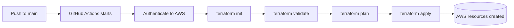
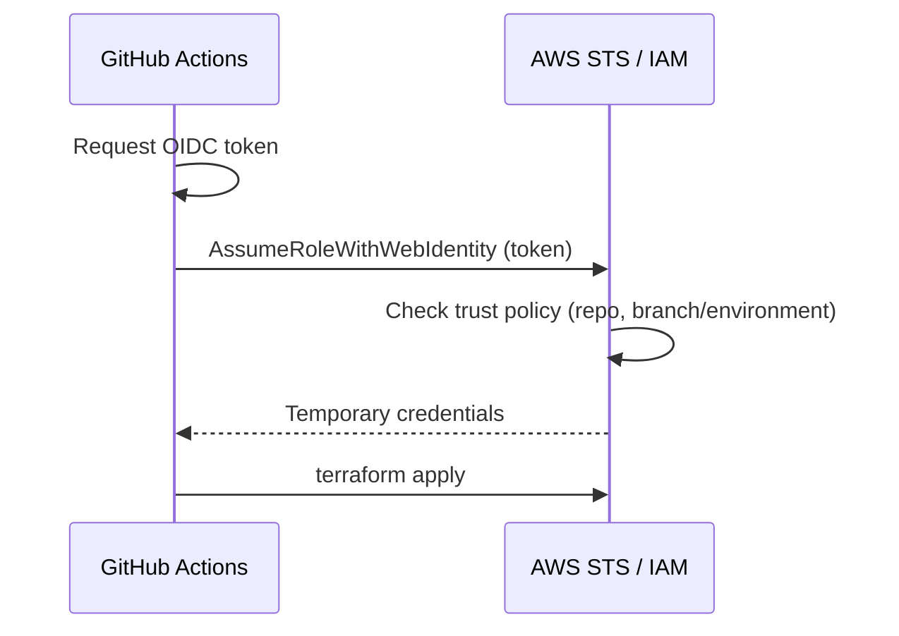

# CI/CD Practice: Terraform + GitHub Actions + AWS (OIDC)

A hands-on project to learn how a CI/CD pipeline works. **GitHub Actions** runs **Terraform** to provision AWS infrastructure (**VPC, Security Group and EC2**) automatically on every push.

The pipeline was built in two stages:

1. **Stage 1: Access keys.** AWS credentials stored as GitHub Secrets.
2. **Stage 2: OIDC.** Keyless authentication, where GitHub assumes an IAM role with short-lived credentials.

## What gets provisioned

| Resource | Purpose |
|---|---|
| VPC | Isolated network for the instance |
| Security Group | Firewall rules for the EC2 instance |
| EC2 instance | The server created by the pipeline |

Region: **us-west-2 (Oregon)**

## Project structure

```
CICD-Pratice/
├── .github/
│   └── workflows/
│       └── terraform-cicd.yml   # GitHub Actions pipeline
├── main.tf                      # VPC, security group, EC2
├── provider.tf                  # Terraform + AWS provider
├── variables.tf                 # Input variables
└── README.md
```

## How the pipeline works



1. A push to `main` triggers the workflow.
2. The runner authenticates to AWS (access keys in Stage 1, OIDC in Stage 2).
3. Terraform runs `init`, `validate`, `plan` and `apply`.
4. The VPC, security group and EC2 instance are created in AWS.

## Stage 1: Access keys

The first version stored `AWS_ACCESS_KEY_ID` and `AWS_SECRET_ACCESS_KEY` as GitHub repository secrets and passed them to the AWS credentials action.

**Drawbacks:** the keys are long-lived, must be rotated manually, and cause real damage if they leak.

## Stage 2: OIDC (no stored keys)

With OpenID Connect, GitHub proves its identity to AWS with a short-lived token. AWS then hands the workflow temporary credentials for an IAM role. **No AWS secret keys are stored in GitHub.**



### OIDC setup steps

1. **Create an IAM identity provider** in AWS:
   - Provider URL: `https://token.actions.githubusercontent.com`
   - Audience: `sts.amazonaws.com`
2. **Create an IAM role** that trusts that provider, with a trust policy limited to this repository, and attach the permissions Terraform needs (EC2 and VPC).
3. **Store the role ARN** in GitHub (as a secret or variable).
4. **Update the workflow** to request the token and assume the role.

Key part of the workflow (example):

```yaml
permissions:
  id-token: write   # allows the job to request an OIDC token
  contents: read

steps:
  - uses: actions/checkout@v4

  - name: Configure AWS credentials (OIDC)
    uses: aws-actions/configure-aws-credentials@v4
    with:
      role-to-assume: ${{ secrets.AWS_ROLE_ARN }}
      aws-region: us-west-2
```

Example trust policy condition, restricting the role to this repo:

```json
"Condition": {
  "StringEquals": {
    "token.actions.githubusercontent.com:aud": "sts.amazonaws.com"
  },
  "StringLike": {
    "token.actions.githubusercontent.com:sub": "repo:priyanshu-0003/CICD-Pratice:*"
  }
}
```

### Access keys vs OIDC

| | Access keys | OIDC |
|---|---|---|
| Credentials stored in GitHub | Yes, long-lived | No |
| Credential lifetime | Until rotated | Minutes (temporary) |
| Risk if leaked | High | Very low |
| Access scoping | Whole IAM user | Per repo, branch or environment |
| Rotation needed | Yes | No |

## How to run

1. Fork or clone this repository.
2. Configure AWS authentication (secrets for Stage 1, or the IAM role for Stage 2).
3. Push to `main`, then watch the run in the **Actions** tab.
4. Check the resources in the AWS console (**us-west-2**).
5. Clean up afterwards by deleting the EC2 instance, security group and VPC, to avoid charges.

## Troubleshooting notes

- **"Not authorized to perform sts:AssumeRoleWithWebIdentity":** the role's trust policy doesn't match the repo, branch or environment in the token. Compare the `sub` claim with the policy. A debug step that prints the token claims helps here.
- **YAML errors:** workflow files are indentation-sensitive, so a misplaced space breaks the run.
- **Wrong region:** make sure the workflow, `variables.tf` and the console all use `us-west-2`.
- **Missing `id-token: write` permission:** OIDC can't work without it.

## What I learned

- How a CI/CD pipeline triggers, authenticates and deploys infrastructure
- Running Terraform from GitHub Actions
- Why long-lived access keys are risky
- How OIDC trust between GitHub and AWS works
- Debugging failed pipeline runs

## Future improvements

- Remote Terraform state in S3 with locking
- Run `plan` on pull requests and `apply` only after approval on `main`
- Tighten the IAM role to least-privilege permissions
- Add security scanning (for example `tfsec` or `checkov`)

## Author

**Priyanshu** · [GitHub](https://github.com/priyanshu-0003)
